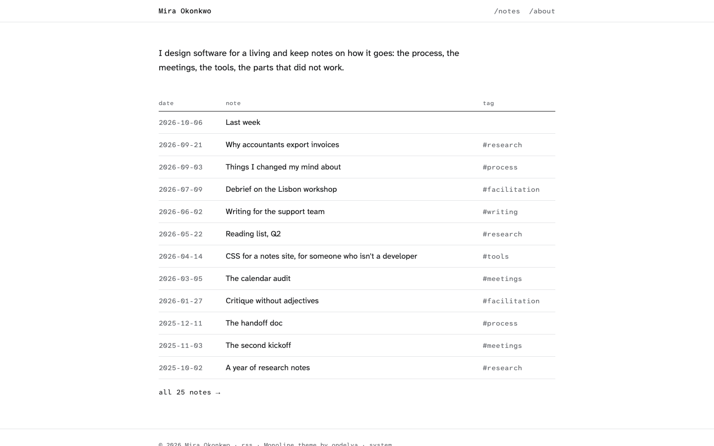

# Monoline

An Astro theme for a notebook of short notes, set like a well-kept plain-text file. Free and MIT-licensed.

[Live demo](https://monoline-free.ondelva.com) · [Pro demo](https://monoline.ondelva.com) ·
[Get Pro](https://buy.polar.sh/polar_cl_MwdBJ0ZMyYjjubu30TEMiE89siUsa5Rh1hBA32Bx3hw)



## What it is

Monoline is for people who keep notes in Markdown and want the site to look like the file: designers, product people, researchers, anyone with a folder of notes worth publishing. Everything structural is in a monospace face: the navigation, the paths, the dates, the titles, the headings. The reading text is in a legible sans. The home page and the index are dense tables, one note per line. The space around a note is left empty.

**The source gutter** is what it is built around. Beside every block of a note, in a narrow grey gutter, sits the Markdown that made it: `##` by a heading, `>` by a quote, `-` and `3.` instead of bullets, a fence by the code, `[^1]` by a footnote. Plain paragraphs have none, so the markers show the note's structure at a glance. You write ordinary Markdown; the markers are read from your files when the site builds. On a phone the gutter folds into a prefix on each block's first line. Turn it off with one setting.

## Features

- Astro 7 + Tailwind CSS v4, static output; the only client-side JavaScript is the theme toggle
- The source gutter for headings, quotes, lists (with their real numbers), code, rules and footnotes
- Home and index as tables of notes: date, title, tag; the index grouped by year
- A note page with its path, word count and reading time, and the older and newer notes
- An About page in the same column, with the gutter
- RSS, sitemap, structured data
- Dark mode, responsive from 360px, Lighthouse 95+ on all four categories, checked in CI
- Type-safe content collection (Markdown and MDX), and `AGENTS.md` for Claude Code / Cursor

## Quick start

You need Node.js 22.12+ and pnpm 9 or newer (`npm i -g pnpm`). `package.json` pins the exact pnpm version, and pnpm 10+ switches to it on its own.

```sh
pnpm create astro@latest my-site -- --template ondelva/astro-theme-monoline
cd my-site
pnpm install
pnpm dev
```

`pnpm dev` also serves `/styleguide`: every colour token, the type, a sample note with its gutter, and the table. It is not part of a build.

## Configure

Everything site-specific lives in `src/config.ts`: your name, the URL, the line at the top of the home page, the switches. Colours are tokens you override in `src/styles/theme.css`.

- [docs/content.md](docs/content.md): writing a note, its fields, the gutter markers
- [docs/customization.md](docs/customization.md): every config group, the tokens, fonts, the footer credit
- [docs/deploy.md](docs/deploy.md): build, hosting, CI

## Deploy

Static output. Works on Cloudflare, Vercel, Netlify and GitHub Pages. One click and the host clones this repository into your account, builds it and puts it online:

[](https://deploy.workers.cloudflare.com/?url=https://github.com/ondelva/astro-theme-monoline)
[](https://app.netlify.com/start/deploy?repository=https://github.com/ondelva/astro-theme-monoline)
[](https://vercel.com/new/clone?repository-url=https://github.com/ondelva/astro-theme-monoline)

Set `SITE_URL` to your address afterwards. See [docs/deploy.md](docs/deploy.md).

## Free vs Pro

The free edition is a finished notes site with the source gutter. Pro adds the ways notes connect to each other, and the ways readers find and follow them:
see it at [monoline.ondelva.com](https://monoline.ondelva.com), and
[buy it here](https://buy.polar.sh/polar_cl_MwdBJ0ZMyYjjubu30TEMiE89siUsa5Rh1hBA32Bx3hw): $49 for one person, $129 for a team of up to ten.

|                | Free                                | Pro                                         |
| -------------- | ----------------------------------- | ------------------------------------------- |
| Pages          | Home, notes index, note, about, 404 | + tag pages, `/now`, search                 |
| Source gutter  | ✓                                   | ✓                                           |
| Links in       | –                                   | `← linked from`, `in` column, `N links in`  |
| Note source    | –                                   | `/notes/<slug>.md` and a `view source` line |
| Search         | –                                   | Pagefind                                    |
| Subscribe      | –                                   | Buttondown form, Giscus comments            |
| Share cards    | One default image                   | One per note                                |
| Colour presets | 1                                   | 4                                           |
| Font pairings  | 1                                   | 2                                           |
| License        | MIT                                 | Commercial, unlimited end products          |
| Footer credit  | One line, easy to remove            | None                                        |
| Support        | GitHub Issues                       | Email (im@ondelva.com), 2 business days     |

## License

MIT, see [LICENSE](LICENSE).
Third-party assets: [THIRD-PARTY-NOTICES.md](THIRD-PARTY-NOTICES.md)
